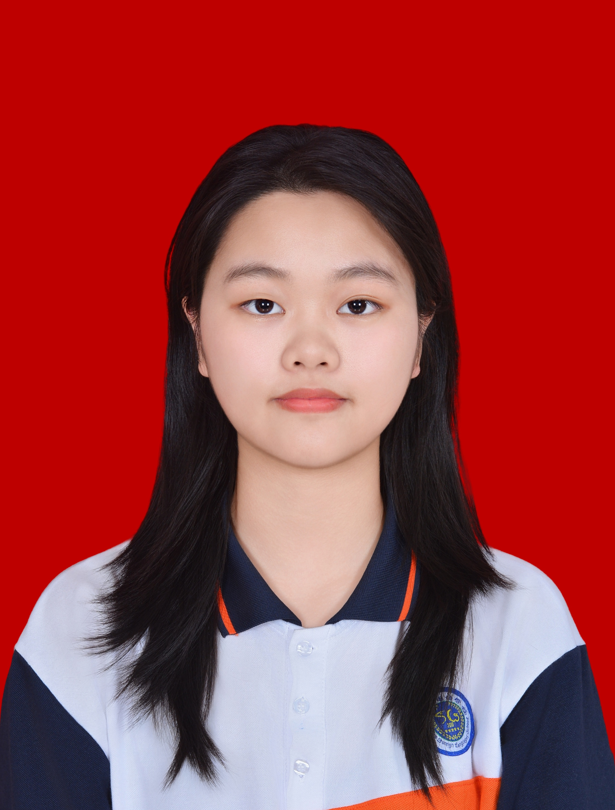

# Chen Jiaying
>_English Communication Student_ 
>_PAYAP UNIVERSITY Chiang Mai 5000, Thailand_   
> jiayingchen503@gmail.com  
---
# About ME
* I am a second-year English Communication student interested in intercultural communication, international projects, and documentary research.
* I enjoy exploring different cultures, conducting research
* I aspire to use my communication and coordination skills to bridge the gap between people, organizations, and conservation initiatives.
* In the future, I hope to gain hands-on experience in wildlife conservation, environmental protection, and field-based documentary research, combining communication with opportunities to engage directly with nature and wildlife.
